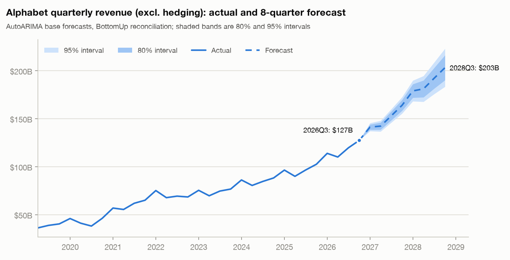
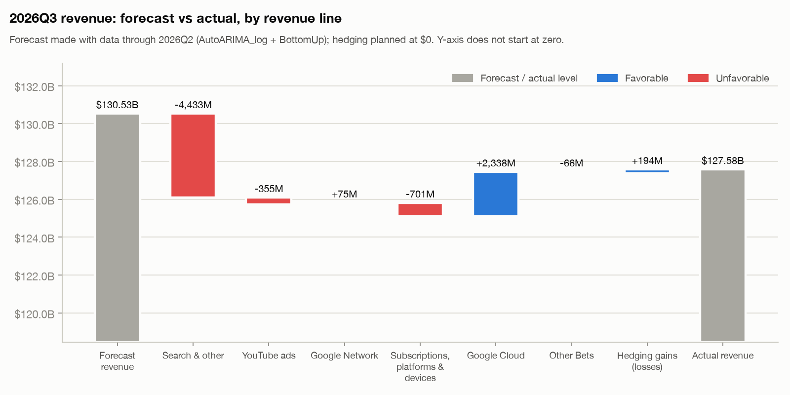
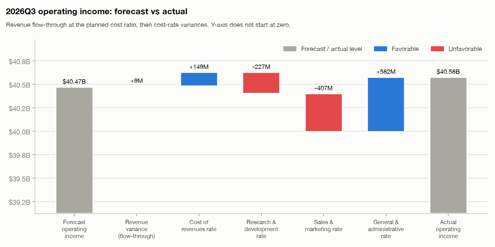
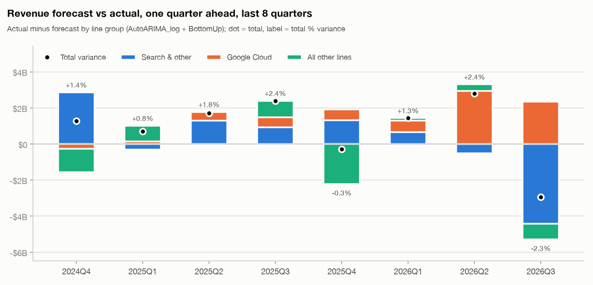

# Alphabet FP&A forecast

[](https://github.com/Allan-dq/alphabet-fpa-forecast/actions/workflows/ci.yml)

> Independent educational project using public filings. Not investment advice. Not affiliated with Google/Alphabet.

A quarterly planning workflow for Alphabet built from its SEC filings:

1. **Data.** Revenue by type, segment results and cost lines are parsed from 41 10-Q/10-K XBRL filings. Each number carries its source, and restatements are detected automatically.
2. **SQL reporting layer.** DuckDB, written in BigQuery-compatible SQL. Views: P&L, revenue mix, OpEx ratios, segment margins, TTM metrics, forecast vs actual, revenue by region, FX exposure, headcount productivity. The same views also run in a BigQuery sandbox (checked against DuckDB) and feed a Data Studio dashboard ([`bigquery/`](bigquery/README.md)).
3. **Hierarchical revenue forecast.** statsforecast models, including log-scale ARIMA and a combination, reconciled with BottomUp, TopDown and MinTrace so that the revenue lines add up to the total. The model and its interval method are chosen on a rolling-origin backtest, by rules committed before the tests ran.
4. **FP&A outputs.**
   - next-4-quarter P&L driven by `assumptions.yaml`, with a capex → depreciation memo;
   - variance bridge for a held-out quarter;
   - an 8-quarter forecast track record;
   - Cloud/Search growth scenarios and an operating-margin sensitivity table;
   - geography and FX exposure;
   - one-page executive summary.

All of it runs with one command, and every number below was produced by that run.

## Results

<!-- RESULTS:START (generated by run_pipeline.py) -->
### Backtest (12 rolling origins, 2023Q2-2026Q1, horizons 1-4 quarters)

Selected by rules fixed in advance ([`docs/experiments.md`](docs/experiments.md)): **AutoARIMA_log + BottomUp**, model prediction intervals.

| | Selected | Seasonal naive | Drift |
|---|---:|---:|---:|
| Total revenue excl. hedging: WAPE | **3.2%** | 14.0% | 5.3% |
| Total revenue excl. hedging: MASE | **0.33** | 1.44 | 0.55 |
| Mean MASE across 8 series | **0.49** | 1.29 | 0.76 |
| 80% interval coverage | 93.2% | 70.2% | 78.9% |
| 95% interval coverage | 96.1% | 92.9% | 88.4% |

<details><summary>By series (selected model)</summary>

| Series | MAPE | WAPE | MASE | Seasonal-naive WAPE | Seasonal-naive MASE | 80% coverage | 95% coverage |
|---|---:|---:|---:|---:|---:|---:|---:|
| Total revenue excl. hedging | 3.2% | 3.2% | 0.33 | 14.0% | 1.44 | 100.0% | 100.0% |
| Google Services | 2.8% | 2.8% | 0.29 | 11.3% | 1.17 | 100.0% | 100.0% |
| Google Cloud | 5.6% | 7.3% | 0.57 | 30.0% | 2.45 | 61.9% | 73.8% |
| Other Bets | 23.4% | 24.2% | 1.31 | 23.4% | 1.32 | 90.5% | 95.2% |
| Search & other | 4.2% | 4.1% | 0.42 | 12.4% | 1.27 | 100.0% | 100.0% |
| YouTube ads | 4.1% | 4.1% | 0.35 | 11.3% | 0.96 | 100.0% | 100.0% |
| Google Network | 2.1% | 2.1% | 0.18 | 2.5% | 0.21 | 100.0% | 100.0% |
| Subscriptions, platforms & devices | 4.7% | 4.8% | 0.46 | 15.2% | 1.49 | 92.9% | 100.0% |

</details>

**Challengers: Google's TimesFM, zero-shot.** TimesFM-2.5 (BottomUp): mean MASE 0.71, total WAPE 5.9%; TimesFM-3.0 (BottomUp): mean MASE 0.56, total WAPE 4.0%. Selected model: 0.49 / 3.2%. [Details](reports/timesfm_challenger.md).

### Forecast



Next 4 quarters (2026Q4-2027Q3): revenue **$610.7B** (29.6% vs the prior 4 quarters),
operating income **$206.9B**, operating margin **33.9%** (prior 4 quarters: 33.3%).
Full P&L: [`reports/pnl_forecast.md`](reports/pnl_forecast.md). Per-line forecasts: [`forecast_lines.png`](reports/figures/forecast_lines.png).

### Variance: 2026Q3 forecast vs actual (held out of model selection)

Revenue -$2,949M (-2.3%), operating income -$3,342M (-7.6%).






### Track record: last 8 quarters, one quarter ahead

Each quarter was forecast with data through the previous quarter only, then compared with what Alphabet reported.

| Configuration | Mean abs. revenue variance | Bias (+ = actual above forecast) | Within ±1% | Mean abs. operating-income variance |
|---|---:|---:|---:|---:|
| production | 1.57% | +0.94% | 2 of 8 | 5.23% |
| real-time selection | 1.53% | +0.42% | 2 of 8 | 5.64% |
| seasonal naive | 17.83% | +17.83% | 0 of 8 | 14.13% |



How the configuration and cost plan were changed after v0.1, under rules committed before the tests ran: [`reports/experiments.md`](reports/experiments.md).

### Executive summary

One page for leadership: [`reports/exec_summary.md`](reports/exec_summary.md) · [PDF](reports/exec_summary.pdf). Scenarios and margin sensitivity: [`reports/scenarios.md`](reports/scenarios.md). Geography and FX: [`reports/geography_fx.md`](reports/geography_fx.md).
<!-- RESULTS:END -->

## Why reconciliation is the FP&A problem

Each business line builds its own forecast (bottom-up), and leadership also has a view of the total (top-down). Independent forecasts of the parts almost never add up to an independent forecast of the whole. Someone has to decide where the gap goes. Hierarchical reconciliation makes that decision explicit and testable:

- **BottomUp**: the total is the sum of the line forecasts.
- **TopDown**: the total forecast is split across the lines.
- **MinTrace (`mint_shrink`)**: every level moves by the smallest amount needed for the hierarchy to add up. Noisier series move more, using a shrinkage estimate of how forecast errors co-move.

The backtest scores all three on the same origins, together with the unreconciled forecasts, so the choice rests on accuracy rather than preference.

```
Total revenue excl. hedging
├── Google Services ── Search & other · YouTube ads · Google Network · Subscriptions, platforms & devices
├── Google Cloud
└── Other Bets
```

## Reproduce

```bash
python3.11 -m venv .venv && source .venv/bin/activate
make install        # pinned requirements.txt + this package
make all            # = python run_pipeline.py: SQL layer, backtest, forecasts, reports, charts, README results
make test           # data, SQL, forecasting and FP&A tests
```

`make all` uses the committed dataset in `data/processed/`, so it needs no network or cloud account. CI runs the same command and checks that the regenerated tables match the committed ones.

To rebuild the dataset from SEC EDGAR (SEC requires a contact in the User-Agent):

```bash
export SEC_USER_AGENT="Your Name your.email@example.com"
make refetch        # downloads 41 XBRL instances (~110 MB) into data/raw/ and rebuilds data/processed/
```

Optional challengers (torch and ~2.2 GB of checkpoints): `pip install -e ".[timesfm]" && python scripts/timesfm_challenger.py`.
- TimesFM 2.5 is Apache-2.0.
- TimesFM 3.0 is under Google's TimesFM Non-Commercial License; it is used here only for this non-commercial educational comparison, and the weights are not redistributed.

## Repository map

| Path | What |
|---|---|
| `src/fpa_forecast/sec_fetch.py`, `xbrl_parse.py`, `dataset.py` | EDGAR download, XBRL parsing, line mapping, vintages, Q4 derivation, restatement detection |
| `data/processed/alphabet_quarterly_long.csv` | One row per quarter × line, with derivation, `restated` flag and source URLs |
| `restatements.md` | Every segment and definition change found, with its size |
| `src/fpa_forecast/earnings_release.py` | Quarter-end headcount parsed from earnings-release exhibits (8-K 99.1) |
| `sql/*.sql`, `src/fpa_forecast/sql_layer.py` | DuckDB tables and views |
| `bigquery/` | Load script, DuckDB-vs-BigQuery check, dashboard views and a Data Studio screenshot |
| `src/fpa_forecast/forecasting.py` | Hierarchy, base models, conformal intervals, reconciliation, backtest, metrics, model selection |
| `src/fpa_forecast/track.py`, `docs/experiments.md` | 8-quarter track record; pre-registered experiments and their amendments |
| `assumptions.yaml`, `src/fpa_forecast/fpa.py` | Cost assumptions, depreciation driver, P&L, variance bridges, scenarios |
| `reports/` | All outputs: markdown, CSV, charts, `exec_summary.pdf`. `reports/sql/` holds CSV extracts of the SQL views |
| `docs/methodology.md` | Methods, selection rule, limitations |
| `tests/` | 70+ tests, including SQL-vs-Python metric agreement, P&L/bridge identities and look-ahead checks |

## Data notes

- **Revenue by type** on today's definitions starts in 2019Q1. Alphabet first disclosed Search, YouTube and Cloud separately in its FY2019 10-K, and never published 2017–2018 quarters on that basis. Total revenue, cost lines and capex go back to 2017Q1.
- **Q4** is fiscal year minus nine months, combining only filings on the same basis.
- **Depreciation** uses `us-gaap:Depreciation`, which the FY2023 10-K introduced in place of a broader tag, so quarterly values start in 2023Q1.
- **Revenue by region** includes hedging in 2017–2018 and excludes it from 2019.
- **Headcount** is not XBRL-tagged. It is parsed from the "Number of employees" row of every earnings release, 2017Q1 onward; each quarter's two reported values agree.
- **Hedging gains (losses)** are tagged separately only from mid-2025 filings. Earlier, they are total revenue minus the segments, and a test checks that they stay under 1.5% of revenue.
- **Restatements found:**
  - Nest moved into Google (2018);
  - performance fees moved out of G&A (2019);
  - DeepMind moved to Alphabet-level and segment cost allocation changed (2023).
  
  No tracked line moved by more than $1M in the 2024–2026 filings. See [`restatements.md`](restatements.md).

## Limitations

- **Short history.** 31 quarters for the revenue lines, and 42 scored forecasts per series. Interval-coverage estimates are noisy.
- **Intervals.** Since experiment E1 the intervals are conservative on stable lines (several cover 100%) and still too narrow for Cloud, whose growth accelerated through the backtest. The Cloud forecast is a statistical baseline, not a capacity- or contract-based view.
- **Costs.** Costs are planned as ratios to revenue.
  - Experiment E2 found the v0.1 "hold cost of revenues flat" judgment overstated it by about 1.5pp.
  - A capex → depreciation pass-through could not be estimated with a plausible sign, so depreciation is shown as a memo and a risk rather than built into the ratio.
- **FX.** The FX sensitivity is mechanical translation only; constant-currency data are not XBRL-tagged.
- **Segment operating income** has basis breaks (2022Q1 and 2023Q2), so it is reported, not forecast.
- **Backtest data.** The backtest uses today's restated data, not real-time vintages. The revenue lines were not restated after 2020.
- **BigQuery / Data Studio.** The BigQuery views match DuckDB, and the Data Studio dashboard exists in the owner's account. It is private, so the repo shows a screenshot instead of a link.

Details: [`docs/methodology.md`](docs/methodology.md).

## License

Code: MIT. Data: derived from public SEC filings.
