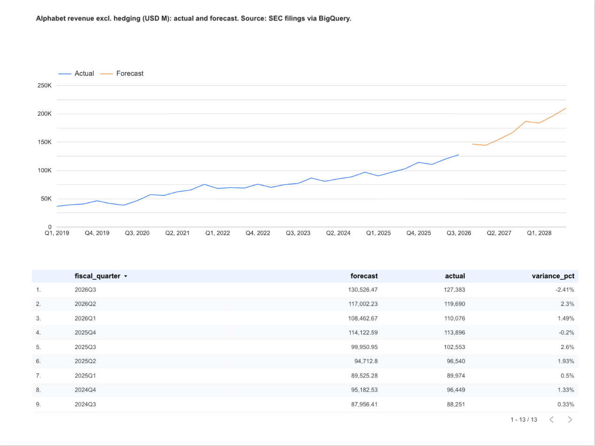

# BigQuery and Data Studio

The SQL views in [`../sql`](../sql) are written in ANSI SQL that DuckDB and BigQuery both accept: conditional aggregation, `LAG`, named `WINDOW` clauses and `NULLIF` division.

This layer has been built in a BigQuery sandbox project (free tier, no billing account) and checked against DuckDB.

## Load and create the views

```bash
python run_pipeline.py                              # produces data/processed/*.csv
gcloud auth login                                   # once
bash bigquery/load_bigquery.sh <your-project-id>    # dataset alphabet_fpa by default
```

`load_bigquery.sh`:
- creates the dataset;
- loads `fact_quarterly`, `dim_line` and `forecasts` with explicit schemas;
- creates the nine views from `sql/0*.sql`, rewriting table names to fully qualified `project.dataset.table`, because BigQuery views cannot rely on a default dataset;
- creates four `dash_*` helper views for the dashboard (`dashboard_views.sql`).

## Verified against DuckDB

```bash
python bigquery/verify_against_duckdb.py <your-project-id>
```

The script compares row counts and the sum of every numeric column for all nine views. On 2026-11-04 every view matched, with a maximum relative difference of 8e-15 (floating-point noise):

| View | Rows |
|---|---:|
| `pnl_quarterly` | 39 |
| `revenue_mix` | 225 |
| `opex_ratios` | 39 |
| `segment_margin` | 108 |
| `ttm_metrics` | 39 |
| `forecast_vs_actual` | 26,112 |
| `revenue_geography` | 156 |
| `fx_exposure` | 31 |
| `productivity` | 39 |

## Dashboard (Data Studio, formerly Looker Studio)



The report reads two BigQuery views:
- **`dash_forecast`:** actual revenue excluding hedging, plus the live 8-quarter forecast.
- **`dash_forecast_track`:** every one-quarter-ahead forecast from the backtest and the holdout. Variance % is actual minus forecast, divided by forecast.

The report lives in the repo owner's Data Studio account and is not shared publicly. The screenshot above is the evidence.
