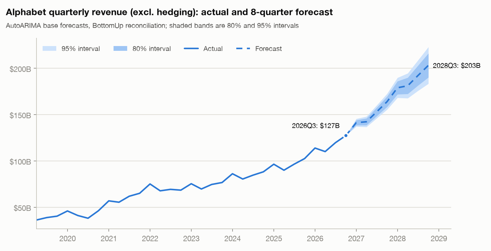

# Alphabet revenue and P&L outlook: 2026Q4 to 2027Q3

*Finance update, data through 2026Q3 (10-Q filed 2026-10-29). Independent educational project using public filings. Not investment advice. Not affiliated with Google/Alphabet.*

For the next four quarters (2026Q4-2027Q3) we forecast revenue of **$600.5B**, 27.5% above the last four reported quarters, and operating income of **$193.2B** (margin **32.2%** vs 33.3%). The model (AutoARIMA + BottomUp reconciliation) was chosen on a 12-origin backtest: total-revenue WAPE 3.9% vs 14.0% for seasonal naive. On the held-out quarter (2026Q3) actual revenue differed from forecast by +$28M (+0.0%) and operating income by +$105M (+0.3%).

**Top 3 drivers**
1. **Google Cloud**: $96.5B of the $129.4B revenue increase (103.6% growth vs the prior four quarters).
2. **Search & other**: $22.3B of the $129.4B revenue increase (8.9% growth vs the prior four quarters).
3. **Operating margin 32.2% vs 33.3%**: the largest cost-ratio move is Research & development at 17.2% of revenue (+1.4pp vs the prior four quarters; `auto` trend in assumptions.yaml).

**Top 3 risks**
1. **Cloud is the swing factor and the least predictable line.** In the backtest only 19% of Cloud outcomes fell inside the 80% interval (growth kept accelerating). The 2027Q3 Cloud forecast is $58.3B with a 95% interval of $52.1B-$64.6B.
2. **Depreciation pressure on cost of revenues.** Trailing-12-month capex reached 33.9% of revenue in 2026Q3 vs 20.2% a year earlier. The plan holds the cost-of-revenues ratio flat year over year; each +1pp would cut operating income by about $6.0B over four quarters.
3. **Search growth.** Search & other is 49.7% of 2026Q3 revenue and came in -1.8% vs forecast in 2026Q3. The downside case (Search -2pp, Cloud -5pp) lowers four-quarter revenue by $9.7B and margin to 31.7%.

**Metrics to watch**
- Google Cloud QoQ growth (24.0% in 2026Q3) and segment margin (36.2%).
- Search & other YoY growth (12.0% in 2026Q3).
- Capex intensity, TTM (33.9%) and cost of revenues as % of revenue.
- Operating-margin range across the Cloud +/-5pp and Search +/-2pp grid: 31.7%-32.6%.

Details: [P&L](pnl_forecast.md) · [backtest](backtest_summary.md) · [variance](variance_2026Q3.md) · [scenarios](scenarios.md) · [method](../docs/methodology.md)
