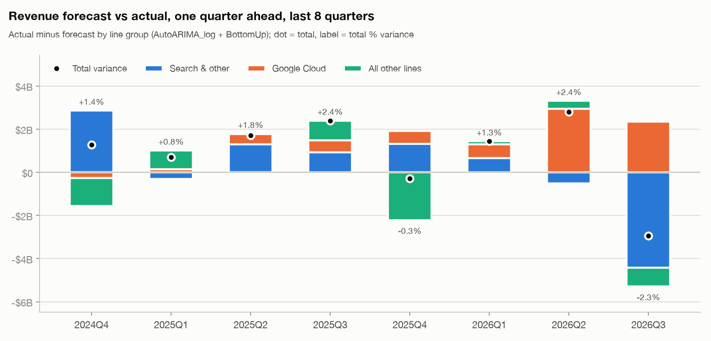

# Experiment results

Pre-registered rules: [`docs/experiments.md`](../docs/experiments.md), committed before any of these results existed.

## E1. Point model and intervals

**Point forecast.** The incumbent (AutoARIMA + BottomUp) has mean MASE 0.514.
The best coherent challenger (AutoARIMA_log + BottomUp) has 0.490, which is
4.8% lower (the threshold is 3%). **Decision: replace the incumbent
→ AutoARIMA_log + BottomUp.**

**Intervals.** For AutoARIMA_log + BottomUp, mean MSIS is 4.44 with model intervals and
4.98 with conformal intervals. **Decision: model intervals.**

Top 10 coherent configurations by mean MASE (model intervals):

| model | method | mean_mase | total_wape | mean_msis | coverage_80 | coverage_95 |
|---|---|---:|---:|---:|---:|---:|
| AutoARIMA_log | BottomUp | 0.490 | 3.2% | 4.44 | 93.2% | 96.1% |
| AutoARIMA_log | MinT | 0.496 | 2.9% | 4.41 | 92.6% | 95.8% |
| AutoARIMA | BottomUp | 0.514 | 3.9% | 4.79 | 76.8% | 86.6% |
| AutoARIMA | MinT | 0.520 | 3.9% | 4.73 | 79.5% | 87.2% |
| AutoARIMA_d1 | MinT | 0.541 | 4.1% | 5.27 | 78.9% | 86.0% |
| AutoARIMA_d1 | BottomUp | 0.542 | 4.3% | 5.37 | 75.3% | 84.2% |
| AutoARIMA | TopDown | 0.547 | 4.4% | 5.24 | 58.9% | 79.5% |
| AutoARIMA_d1 | TopDown | 0.556 | 4.4% | 5.67 | 61.6% | 78.6% |
| Combo | BottomUp | 0.567 | 5.1% | 5.18 | 77.4% | 86.6% |
| Combo | TopDown | 0.590 | 5.5% | 8.99 | 68.5% | 81.2% |

Interval kinds for the selected configuration:

| intervals | mean_msis | coverage_80 | coverage_95 |
|---|---:|---:|---:|
| model | 4.44 | 93.2% | 96.1% |
| conformal | 4.98 | 78.9% | 89.3% |

Same comparison for the previous production configuration:

| intervals | mean_msis | coverage_80 | coverage_95 |
|---|---:|---:|---:|
| model | 4.79 | 76.8% | 86.6% |
| conformal | 5.97 | 61.9% | 72.3% |

Reading the result:
- **Better calibrated, but now conservative.** Log-scale modeling widened the intervals where growth compounds, so coverage rose toward or above nominal. Several stable lines now reach 100% coverage, meaning their intervals are wider than needed. Cloud is still under-covered, though much less than before.
- **Conformal lost.** With 2 calibration windows, split-conformal intervals rest on very few errors per horizon, so they came out too narrow.

## E2. Cost of revenues: capex → depreciation driver

One-quarter-ahead cost-of-revenues ratio (% of revenue), actual revenue as the denominator:

| quarter | actual_pct | incumbent_pct | driver_pct | auto_trend_pct | s | k |
|---|---:|---:|---:|---:|---:|---:|
| 2024Q4 | 42.10 | 43.53 | 44.07 | 41.58 | +1.00 | 0.0181 |
| 2025Q1 | 40.30 | 41.86 | 39.72 | 40.28 | -3.03 | 0.0178 |
| 2025Q2 | 40.49 | 41.90 | 40.16 | 40.43 | -2.71 | 0.0205 |
| 2025Q3 | 40.42 | 41.32 | 39.27 | 39.72 | -2.42 | 0.0218 |
| 2025Q4 | 40.21 | 42.10 | 40.00 | 40.77 | -1.97 | 0.0234 |
| 2026Q1 | 37.55 | 40.30 | 38.08 | 38.85 | -1.98 | 0.0237 |
| 2026Q2 | 38.35 | 40.49 | 38.54 | 38.75 | -2.15 | 0.0227 |
| 2026Q3 | 40.30 | 40.42 | 38.69 | 38.50 | -2.22 | 0.0196 |

| Method | Mean absolute error (pp) | Mean error (pp, + = overstated) |
|---|---:|---:|
| Incumbent: same quarter last year + 0.0pp | 1.52 | +1.52 |
| Challenger: depreciation driver | 0.82 | -0.15 |
| Reference: same quarter last year + `auto` trend | 0.67 | -0.11 |

**Pre-registered rule:** adopt the driver if its mean absolute error is lower. That condition is
**met**.

**Deviation from the rule: the driver was not adopted.**
- The pass-through coefficient s is negative once it can be estimated (from 2025Q1): -3.03 to -1.97. Read literally, a rising depreciation share would *lower* the cost-of-revenues ratio, which is not economically plausible.
- What the regression actually captures is the downward trend in the ratio, which happened while depreciation intensity rose. So the "driver" is a disguised trend model, not a depreciation model.
- Shipping it would put a wrong-signed relationship into the plan.

**What changed instead:**
- The experiment also showed that the v0.1 judgment override (hold the ratio flat) overstated cost of revenues by +1.52pp on average.
- `assumptions.yaml` now uses the default rule for cost of revenues (same quarter last year + `auto` trend), the same rule R&D and S&M already use. In this comparison it also had the lowest error (0.67pp). That is disclosed here because it was seen before the switch.
- The capex → depreciation link is sensible (k > 0) and is kept as a memo projection in [`pnl_forecast.md`](pnl_forecast.md) and as a risk in the executive summary.

## E3. Forecast track record (last 8 quarters, one quarter ahead)

| Configuration | Mean abs. revenue variance | Revenue bias (+ = beat) | Worst quarter | Quarters within ±1% | Mean abs. operating-income variance | OI bias |
|---|---:|---:|---:|---:|---:|---:|
| production | 1.57% | +0.94% | 2.40% | 2 of 8 | 5.23% | -2.29% |
| real-time selection | 1.53% | +0.42% | 2.39% | 2 of 8 | 5.64% | -2.78% |
| seasonal naive | 17.83% | +17.83% | 24.40% | 0 of 8 | 14.13% | +14.13% |

Production configuration by quarter (USD millions; variance = actual − forecast):

| quarter | model | revenue_forecast | revenue_actual | revenue_variance | revenue_variance_pct | oi_variance_pct | var_Search & other | var_Google Cloud | var_All other lines |
|---|---|---:|---:|---:|---:|---:|---:|---:|---:|
| 2024Q4 | AutoARIMA_log + BottomUp | 95,183 | 96,469 | +1,286 | +1.35% | +0.29% | +2,857 | -262 | -1,309 |
| 2025Q1 | AutoARIMA_log + BottomUp | 89,525 | 90,234 | +709 | +0.79% | -1.67% | -300 | +151 | +858 |
| 2025Q2 | AutoARIMA_log + BottomUp | 94,713 | 96,428 | +1,715 | +1.81% | -5.11% | +1,299 | +482 | -66 |
| 2025Q3 | AutoARIMA_log + BottomUp | 99,951 | 102,346 | +2,395 | +2.40% | -9.62% | +932 | +544 | +919 |
| 2025Q4 | AutoARIMA_log + BottomUp | 114,123 | 113,829 | -294 | -0.26% | -6.08% | +1,314 | +605 | -2,212 |
| 2026Q1 | AutoARIMA_log + BottomUp | 108,463 | 109,896 | +1,433 | +1.32% | +8.31% | +653 | +638 | +142 |
| 2026Q2 | AutoARIMA_log + BottomUp | 117,002 | 119,796 | +2,794 | +2.39% | +3.14% | -512 | +2,951 | +355 |
| 2026Q3 | AutoARIMA_log + BottomUp | 130,526 | 127,577 | -2,949 | -2.26% | -7.61% | -4,433 | +2,338 | -854 |

Direction of misses (production): Search & other: actual above forecast in 5 of 8 quarters, below in 3; Google Cloud: actual above forecast in 7 of 8 quarters, below in 1; All other lines: actual above forecast in 4 of 8 quarters, below in 4.

Real-time selection picked, quarter by quarter (only backtest targets before that quarter):
2024Q4: AutoARIMA_log + MinT, 2025Q1: AutoARIMA_log + MinT, 2025Q2: AutoARIMA_log + MinT, 2025Q3: AutoARIMA_log + MinT, 2025Q4: AutoARIMA_log + MinT, 2026Q1: AutoARIMA_log + BottomUp, 2026Q2: AutoARIMA_log + BottomUp, 2026Q3: AutoARIMA_log + BottomUp.

Caveats:
- The production configuration was selected with backtest targets through 2026Q2, so its track record is not fully out of sample.
- Real-time selection is out of sample at every quarter.
- Operating-income variance also reflects the cost assumptions as they would have been resolved at each quarter.
