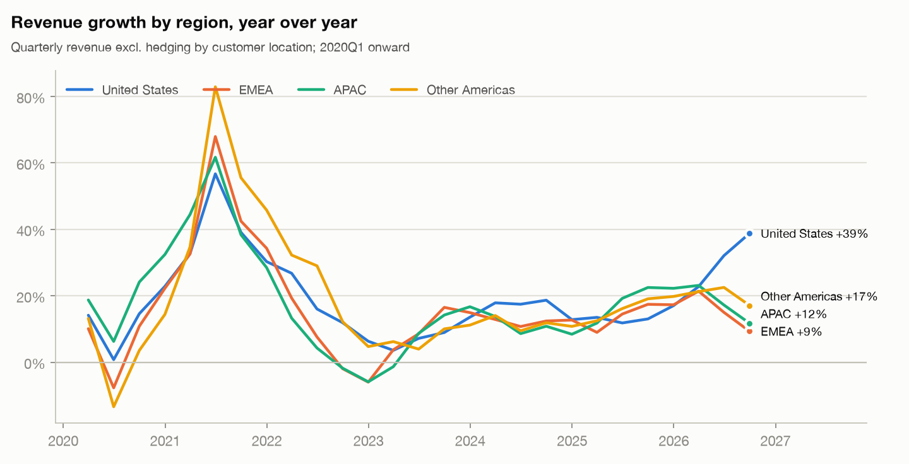

# Geography and FX

Revenue by customer location (`sql/07_revenue_geography.sql`) and an FX lens (`sql/08_fx_exposure.sql`).
From 2019 the regions sum to revenue excluding hedging gains (losses). The 2017–2018 regional figures
include hedging, so comparisons across 2019 have a small break.

## 2026Q3

| region | revenue | share | yoy_growth |
|---|---:|---:|---:|
| APAC | 19,906 | 15.6% | +11.7% |
| EMEA | 32,695 | 25.7% | +9.3% |
| Other Americas | 7,101 | 5.6% | +17.1% |
| United States | 67,681 | 53.1% | +38.8% |

## YoY growth by region, last 8 quarters

| fiscal_quarter | APAC | EMEA | Other Americas | United States |
|---|---:|---:|---:|---:|
| 2024Q4 | +8.4% | +12.7% | +10.8% | +12.8% |
| 2025Q1 | +11.8% | +9.0% | +12.5% | +13.5% |
| 2025Q2 | +19.2% | +14.5% | +16.1% | +11.8% |
| 2025Q3 | +22.5% | +17.4% | +19.1% | +13.0% |
| 2025Q4 | +22.2% | +17.3% | +19.8% | +17.0% |
| 2026Q1 | +23.1% | +21.4% | +21.2% | +22.8% |
| 2026Q2 | +17.2% | +15.0% | +22.5% | +32.1% |
| 2026Q3 | +11.7% | +9.3% | +17.1% | +38.8% |

## FX exposure

- **Non-US share:** 49.5% of revenue excluding hedging over the last 4 quarters, vs 54.3% in 2019Q1.
- **Hedging results:** gains (losses) ranged from -$207M to +$260M per quarter over the last 8 quarters, i.e. -0.38% to +0.57% of non-US revenue.
- **Translation sensitivity (mechanical):** if the US dollar were 5% stronger against every currency for the next 4 quarters, non-US revenue would translate about **$15.1B lower** (next-4-quarter revenue excl. hedging × trailing non-US share × 5%), before hedging gains. Recent hedging results are small next to that, so most of a broad USD move would reach reported revenue.
- **Not available:** Alphabet's constant-currency growth figures are in the MD&A text and are not XBRL-tagged, so they are not used here.
