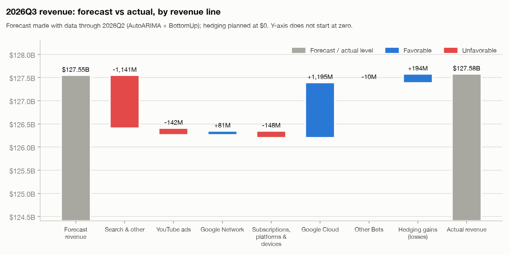
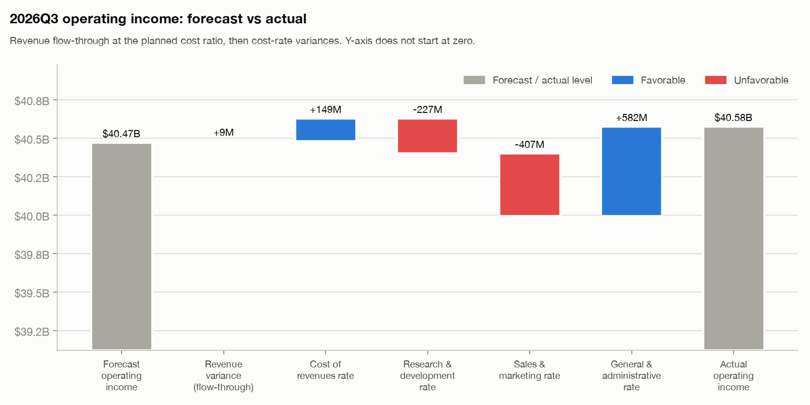

# Variance analysis: 2026Q3 forecast vs actual

The 2026Q3 forecast uses only data through 2026Q2: revenue from the selected model (h = 1), costs from
`assumptions.yaml` resolved as of 2026Q2. 2026Q3 was not used for model selection.

| index | forecast | actual | variance | variance_pct |
|---|---:|---:|---:|---:|
| Search & other | 64,491.2 | 63,350.0 | -1,141.2 | -1.8% |
| YouTube ads | 11,349.3 | 11,207.0 | -142.3 | -1.3% |
| Google Network | 7,374.0 | 7,455.0 | +81.0 | +1.1% |
| Subscriptions, platforms & devices | 14,438.4 | 14,290.0 | -148.4 | -1.0% |
| Google Cloud | 29,514.4 | 30,709.0 | +1,194.6 | +4.0% |
| Other Bets | 382.0 | 372.0 | -10.0 | -2.6% |
| Hedging gains (losses) | 0.0 | 194.0 | +194.0 | +inf% |
| Total revenues | 127,549.3 | 127,577.0 | +27.7 | +0.0% |
| Cost of revenues | 51,556.4 | 51,419.0 | -137.4 | -0.3% |
| Research & development | 20,408.1 | 20,640.0 | +231.9 | +1.1% |
| Sales & marketing | 8,395.2 | 8,804.0 | +408.8 | +4.9% |
| General & administrative | 6,718.6 | 6,138.0 | -580.6 | -8.6% |
| Total costs and expenses | 87,078.3 | 87,001.0 | -77.3 | -0.1% |
| Operating income | 40,471.0 | 40,576.0 | +105.0 | +0.3% |
| Operating margin (%) | 31.7 | 31.8 | +0.1 |  |

## Cost ratios: plan vs actual

| index | Planned % of revenue | Actual % of revenue | Difference (pp) |
|---|---:|---:|---:|
| Cost of revenues | 40.42% | 40.30% | -0.12 |
| Research & development | 16.00% | 16.18% | +0.18 |
| Sales & marketing | 6.58% | 6.90% | +0.32 |
| General & administrative | 5.27% | 4.81% | -0.46 |

## What drove the miss

- Revenue came in +$28M (+0.0%) vs forecast.
- Google Cloud: +$1,195M
- Search & other: -$1,141M
- Hedging gains (losses): +$194M
- Operating income came in +$105M (+0.3%) vs forecast; largest drivers: General & administrative rate +$582M; Sales & marketing rate -$407M; Research & development rate -$227M.
